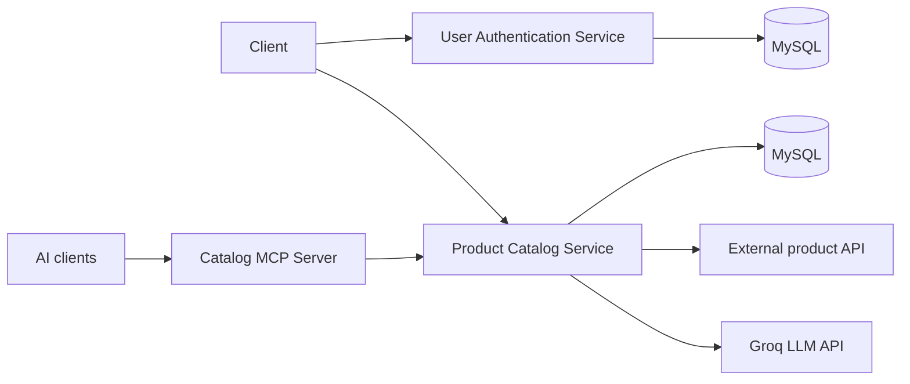

# Shop-Nest

Microservices-based e-commerce backend in Java and Spring Boot: JWT auth, product catalog, AWS deployment, and an MCP server for AI access to catalog data.

## Overview

Shop-Nest is a backend e-commerce platform split into independent services. It supports user registration and login, **role-based access (Admin / User)**, product browsing and search, and LLM-generated product pitches. A separate MCP server exposes catalog data to AI tools.

## Repositories

| Service | Description | Repo |
|---|---|---|
| **User Authentication Service** | Registration, login, JWT issuing and role-based authorization | [User Auth](https://github.com/abhijeet-00/UserAuthService) |
| **Product Catalog Service** | Product browsing, categories, search and product management | [Product Catalog](https://github.com/abhijeet-00/ProductCatalogService) |
| **Catalog MCP Server** | Exposes product retrieval tools to AI clients via Model Context Protocol | [MCP Catalog](https://github.com/abhijeet-00/MCP-Catalog) |

## Architecture



## Access Control

Authentication uses **JWT**. Read endpoints are public; all write endpoints require a valid token.

| Operation | Public (no token) | User | Admin |
|---|---|---|---|
| Read (GET) | Yes | Yes | Yes |
| Create (POST) | No | Yes | Yes |
| Update (PUT/PATCH) | No | Yes | Yes |
| Delete (DELETE) | No | No | Yes |

## Key Features

- **JWT authentication** and **role-based authorization** (Admin / User) using Spring Security
- **Public read APIs** for product browsing, categories and search; **token-protected** create, update and delete
- **Product management** for authenticated users, with delete restricted to Admins
- Catalog data **seeded from an external API**
- **LLM-generated product pitches** using the Groq API
- **Custom MCP server** exposing product retrieval tools to AI clients

## Tech Stack

- **Language and framework:** Java 17, Spring Boot, Spring Security, Spring Data JPA, Hibernate
- **Auth:** JWT
- **Database:** MySQL (AWS RDS in higher environments)
- **Testing:** JUnit, Mockito
- **Build:** Maven
- **Cloud and CI/CD:** AWS Elastic Beanstalk, AWS RDS, GitHub Actions
- **AI:** Groq LLM API, Model Context Protocol (MCP)

## Testing

Unit tests are written with **JUnit** and **Mockito** and live in the [Product Catalog Service](https://github.com/abhijeet-00/ProductCatalogService) repo. Tests for the User Authentication Service are in progress.

Run the unit tests with:

```bash
mvn -q test -Dtest='GroqPitchServiceTests,ProductInventoryServiceTests,DummyProductServiceTests,CategoryServiceTests'
```

Integration tests need a dedicated test database and will be added later.

## Deployment

Both services are deployed on **AWS Elastic Beanstalk**, using **RDS MySQL** in higher environments. **GitHub Actions** builds and deploys automatically on every push to **main** branch.

## Development Approach

Built with an AI-assisted workflow using **GitHub Copilot** and **OpenCode** for code generation and refactoring. I designed the service boundaries and security rules and reviewed all generated code. **Context7** and **Notion MCP servers** were used to pull dependency documentation and keep project notes.

## Status

In progress: unit tests for the User Authentication Service, integration tests, Docker and Kafka-based messaging.

## Author

Abhijeet Singh | [LinkedIn](https://www.linkedin.com/in/abhijeet-singh-33b13821a/) | [GitHub](https://github.com/abhijeet-00)
